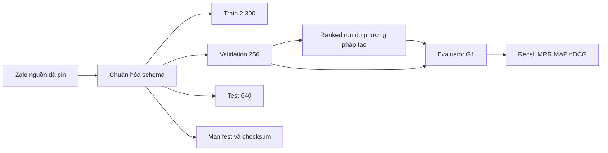
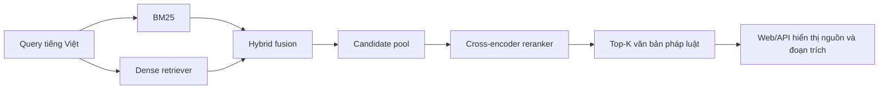

# Pipeline dự án và kiến trúc đích

Tài liệu này tách riêng luồng đã thực thi trong project khỏi kiến trúc tham khảo và kế hoạch các tuần sau. Revision kho mã tham khảo được ghi trong `docs/reproducibility/source_manifest.json`.

## Luồng đã chạy: G0 trên subset BKAI/YuITC

```mermaid
flowchart LR
    A[BKAI corpus] --> C[Subset 5.000 tài liệu]
    B[YuITC train queries và qrels] --> C
    C --> D[Chuẩn bị và lập chỉ mục]
    D --> E[Boolean]
    D --> F[TF-IDF]
    D --> G[BM25]
    E --> H[Ranked document IDs]
    F --> H
    G --> H
    H --> I[Evaluator trên qrels]
    I --> J[Recall@10, MAP, nDCG@10]
    H --> K[Top-K, score, excerpt]
```

Project chuẩn bị subset và gọi các phương pháp tham khảo Daijestic theo revision đã pin. Relevant CID được giữ trong subset trước khi bổ sung đủ 5.000 tài liệu. Các metric chạy trên 100 query; 10 query thủ công có output Top-5. Đây là kiểm tra pipeline, không đại diện cho toàn corpus.

## Luồng hiện có: G1 khóa dữ liệu và chấm run



G1 đã chuẩn hóa và khóa các split, báo cáo dữ liệu, định nghĩa metric và evaluator. Chưa có phương pháp nào tạo ranked run trên Zalo. Lịch triển khai kế tiếp là G2/BM25 trên validation.

## Kiến trúc mục tiêu theo đề tài



Đây là kiến trúc đích dự kiến theo đề cương, không phải trạng thái đã hoàn thành. Theo lộ trình, trước hết phải có BM25 benchmark G2; dense retrieval, fusion, reranking và web/API được làm ở các gate sau.

## Những gì quan sát trong repository tham khảo thứ hai

`chisngooo/Vietnamese-Legal-Document-Retrieval` có code cho BM25, SentenceTransformer/BGE-M3, FAISS, fusion và BGE cross-encoder. Đây là nguồn đọc kiến trúc, không phải sản phẩm đã chạy trong project.

- BM25 dùng `rank_bm25.BM25Okapi` và tiền xử lý theo repository.
- Dense dùng SentenceTransformer và FAISS.
- Fusion có nhiều biến thể; nhánh mặc định được ghi nhận là `product_rank`, không gọi nhầm thành RRF.
- Reranker chấm các cặp query–candidate sau bước fusion.
- Evaluator của repo đó khác evaluator G1 của project.

Không sao chép các kết quả hay sơ đồ tham khảo thành bằng chứng triển khai. Trạng thái từng gate được theo dõi tại `README.md`, `docs/g0_acceptance.md` và `docs/g1_data_lock.md`.
